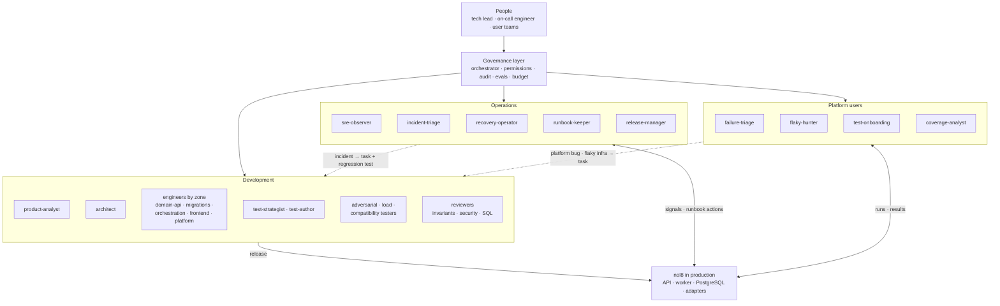
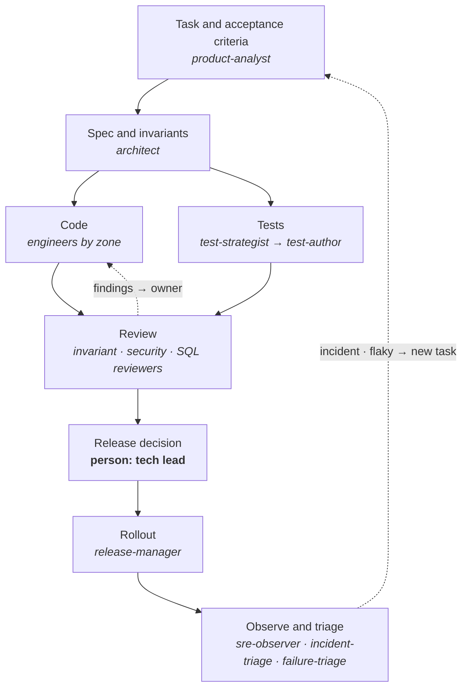

# Agent network

How work on this platform is split between AI agents and people once it runs
as a product rather than a take-home. Agent definitions live in
[`.claude/agents/`](../.claude/agents/); the main Claude Code session acts as
the orchestrator.

Two rules hold everywhere:

- **One result, one owner.** Every artifact (a migration, a test file, a
  review, a runbook) has exactly one agent responsible for it. Review comments
  go back to that owner, not to whoever happens to be free.
- **Agents propose, people decide** on anything outward-facing: pushing to
  `main` (it deploys), running commands on the server, changing secrets,
  triggering workflows, acting on a live incident.

## Overview

Dashed arrows are feedback: anything learned in production or from users
comes back as a task with a test that reproduces it.

## Life of a change

Code and tests are written from the same spec, in parallel, by different
agents. The test author does not read the implementation first: tests derived
from the code confirm its bugs instead of catching them. This matters most for
the worker, locking and recovery paths.

## Roster

### Development

| Agent | Owns | Writes to |
|---|---|---|
| `product-analyst` | Tasks with acceptance criteria | task text only |
| `architect` | Design decisions, README architecture sections | `README.md`, `docs/` |
| `domain-api-engineer` | State machine, `RunConfig`, use cases, HTTP layer | `app/domain/`, `app/services.py`, `app/api/` |
| `migrations-engineer` | Models, `RunRepository`, Alembic migrations | `app/persistence/`, `alembic/versions/` |
| `orchestration-engineer` | Executor, worker, claim/lease/fencing, adapters | `app/orchestration/`, `app/adapters/`, `app/worker_service.py` |
| `frontend-engineer` | The SPA | `frontend/src/` |
| `platform-engineer` | Image, compose files, CI and deploy workflows | `Dockerfile`, `deploy/`, `.github/`, `docker-compose.yml` |
| `test-strategist` | Test plan and failure catalogue for a change | plan only |
| `test-author` | Unit, integration, API and frontend tests | `backend/tests/`, `frontend/src/**/*.test.tsx` |
| `adversarial-tester` | Tests that try to break locking, fencing, recovery | `backend/tests/integration/` |
| `load-tester` | Throughput and contention measurements | scenario scripts, report |
| `compatibility-tester` | Old/new code against new/old schema during a rollout | `backend/tests/integration/` |
| `invariant-reviewer` | Review against the CLAUDE.md invariants | review only |
| `security-reviewer` | Secrets, injection, exposure, dependencies | review only |
| `sql-reviewer` | Query plans, indexes, lock behaviour, migration safety | review only |

### Operations

| Agent | Owns | Acts on production |
|---|---|---|
| `sre-observer` | Health and anomaly reports | read-only, public API |
| `incident-triage` | Incident timeline and probable cause | read-only |
| `recovery-operator` | Exact runbook procedure for a stuck run or worker | never: hands commands to a person |
| `runbook-keeper` | Runbooks and post-incident follow-ups | `docs/runbooks/` |
| `release-manager` | Release checklist, changelog, rollback criteria | never: a person pushes |

### Platform users

| Agent | Owns | Output |
|---|---|---|
| `failure-triage` | Why a run failed: product, test, environment or platform | triage note |
| `flaky-hunter` | Tests whose outcome changes without a code change | evidence and owner |
| `test-onboarding` | Helping a team add tests to the catalogue | seed/catalogue change |
| `coverage-analyst` | Gaps, slow tests, what to parallelise | report |

Several operations and user agents need data the platform does not collect
yet (metrics, logs with run id, run history beyond the database, see
"What I would change for production" in the README). Until then they work
from `/api/runs`, `/api/health` and CI logs, and say so when the evidence is
thin.

## Governance

- **Permissions by role.** Development agents never touch production;
  operations agents never change code. Reviewers and analysts have no write
  tools. Project-wide `ask`/`deny` rules in `.claude/settings.json` apply to
  every agent.
- **Audit.** Every agent's output names its evidence: file and line, test
  name, run id, CI job.
- **Evals.** Periodically check how many review findings were real, how
  often triage was right, how many alerts were noise. A noisy agent loses
  scope before it gains any.
- **Budget.** Each contour gets its own time and token budget; overnight
  batches (dependency bumps, flaky reruns, doc drift checks) produce PRs and
  reports for a person to read in the morning, never merges.

## Rollout order

1. `invariant-reviewer` and an independent `test-author`: lowest risk,
   immediate value.
2. `failure-triage` and `flaky-hunter`: most visible to platform users.
3. `sre-observer` and `incident-triage`, read-only.
4. `recovery-operator` only after triage has earned trust, and still
   handing commands to a person.
